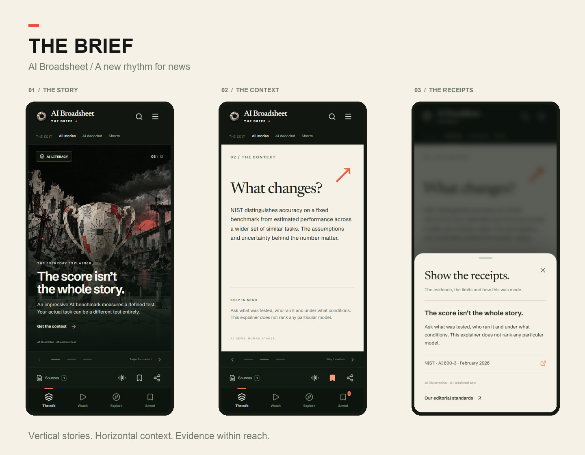

# The Brief — mobile product and release notes

An app edition at `/app` and `/fr/app`, within the existing AI Broadsheet website. The installable PWA opens this edition. The newspaper remains at `/`.

Validation: production build and TypeScript passed; 15 cache/reading-list checks, 6 Brief integrity checks and 23 browser checks passed. Browser coverage includes 320, 390, 430 and 1440px layouts, persistence, source drawer, WhatsApp URL, video play/pause, French deep links and the static offline reading list. Store signing and physical iOS/Android device verification are still separate release tasks.

## Research and audience

Design focus: young adults, initially 18–30. This is a product hypothesis, not an established description of the site's current audience.

- Pew's December 2025 US teen survey identifies YouTube, TikTok, Instagram and Snapchat as widely used. These US ages 13–17 figures cannot be extrapolated to all countries or to 18–30-year-olds. https://www.pewresearch.org/internet/2025/12/09/teens-social-media-and-ai-chatbots-2025/
- Pew's April 2026 analysis distinguishes entertainment and interest discovery on TikTok/Instagram from Snapchat's stronger direct-messaging role. News is a reason for use for about four-in-ten or more TikTok/Instagram users in that sample, versus about a quarter on Snapchat. https://www.pewresearch.org/internet/2026/04/15/teens-experiences-on-tiktok-instagram-and-snapchat/
- Reuters Institute's Digital News Report 2026 documents the growing role of platforms and news video. https://reutersinstitute.politics.ox.ac.uk/digital-news-report/2026

These sources support testing short visual formats. They do not prove a single format will perform best for AI Broadsheet. No claim about guaranteed reach, virality or retention is made.

## Experience

- One story per vertical viewport; scroll or keyboard arrows for the next story.
- Three horizontal frames: the story, context, receipts. Visible frame buttons supplement swiping.
- A finite editorial edition with an explicit end. No fake view counts, like counters or engagement bait.
- Separate Watch feed; direct user-initiated video playback. Videos start muted, pause when offscreen, behind a panel or when the page is hidden. Seek and mute controls are available.
- Synthetic speech on request through the device/browser speech system. Label the synthetic voice and stop it on story changes, hidden page, panel opening or leaving the app. No TTS API or paid music service is invoked.
- Saved metadata remains locally on the device, capped at 100 briefs; corrupt storage cannot crash the app. Blocked storage produces an honest failure notice.
- Native share, WhatsApp handoff and copy-link fallback. Sharing opens a composer; it does not send messages automatically.
- Source drawers use Radix Dialog for focus containment and Escape dismissal. At least 44px action targets, reduced-motion support, full transcripts where available, source links and AI labels.
- Search and topic filtering run locally. No opaque personalization profile is collected.

## Visual direction

Warm editorial paper outside, forest-charcoal inside, restrained vermilion, original paper-sculpture photography and a small Mercek aperture mark. Headlines have a strong hierarchy with short readable summaries. Controls remain quiet and consistent. No yellow AB symbol.

## Content and integrity

The existing published newsroom summaries and publishable site-owned original video files feed the edition. There are no new model calls. Three original, sourced AI-literacy pieces provide a useful initial edition when the newsroom is unavailable. They are labeled evergreen explainers, without fabricated publication dates or live status.

The summary index contains outlet names but not source URLs. The app links to each full article's real source ledger instead of inventing publisher links. Existing music rights holds apply to the app player too.

English/French interface and original evergreen copy are included. Existing English-only video productions retain their English content and credits.

## Audio, music and future production

The demo edit is silent with on-screen text; do not claim it has a soundtrack. Existing original videos retain their own credited audio. Owner-licensed music can be added to future edits after checking the specific recording's rights. An optional sonic identity should be an original two-note cue, off by default and triggered only by user action. No licensed track, Flow generation or Suno subscription is purchased by this change.

## Measurement

Existing Cloudflare page analytics can measure `/app` visits, referrers and devices. Custom event reporting is not claimed by this release. Before optimizing, agree on consent-compatible measurement for story completions, source opens, saves, shares initiated and seven-day returns. A WhatsApp handoff does not prove a message was sent. No inferred age, employer, job status or individual identity is collected.

## Deployment

Implementation lives in GitHub. No Lovable agent build or credit-consuming operation is needed. PR validation includes TypeScript, the production build, the existing mobile/cache tests, new saved-content and media-rights checks, and responsive browser tests. Native App Store / Play Store signing and listings are outside this PWA release.

## Model setting

For this broad UX, editorial and engineering task: GPT-6 Astra, High reasoning. For economical routine implementation: GPT-6.1 Sol, High. These are task-specific recommendations based on the official model guidance, not a claim that the same text model generates finished music or video. https://developers.openai.com/api/docs/guides/model-selection
